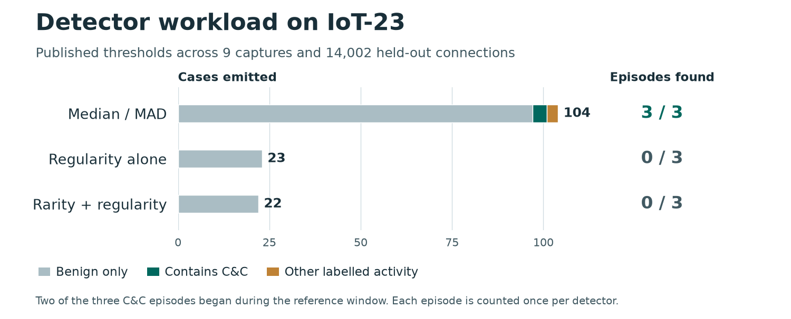

# Security Anomaly ML

Investigate unusual network connections on your own machine. Give the CLI a Zeek connection log and an earlier reference from the same sensor. It returns a ranked queue with the endpoints, connection UIDs and measurements that explain each case. For CICFlowMeter exports, a frozen Random Forest groups flow alerts into incidents.

[](https://github.com/ibondarenko1/security-anomaly-ml/actions/workflows/ci.yml) · [PyPI](https://pypi.org/project/security-anomaly-ml/) · [Container](https://github.com/ibondarenko1/security-anomaly-ml/pkgs/container/security-anomaly-ml) · [Apache 2.0](https://github.com/ibondarenko1/security-anomaly-ml/blob/main/LICENSE)

## Try it on four connections

In the bundled synthetic Zeek capture, connection `H2` goes from `192.0.2.51:43001` to `198.51.100.12:8443` over TCP. Eight earlier connections establish the sensor profile. Of the four accepted UIDs in the next log, three have complete measurements. Only `H2` crosses the alert threshold.

| Measurement | Reference median | Connection H2 |
|---|---:|---:|
| Duration | 0.20 s | 30.0 s |
| Response bytes | 239.5 B | 24,000 B |
| Response packets | 5 | 120 |

Run this in a Python 3.13 virtual environment. The package includes both example logs. The Zeek commands work offline after installation.

```bash
python -m pip install security-anomaly-ml==0.2.0
security-anomaly demo zeek --output-dir zeek-example
security-anomaly zeek-fit zeek-example/fit.jsonl --sensor edge --output profile.json
security-anomaly zeek-score zeek-example/heldout.jsonl --sensor edge --profile profile.json --output findings.jsonl
```

Open `findings.jsonl` and find `H2` at `evidences[0].uid`. The same evidence contains the observed values, baseline and strongest deviations. The local Sentinel exporter wraps this finding for a custom table. [Zeek fields](https://github.com/ibondarenko1/security-anomaly-ml/blob/v0.2.0/docs/ZEEK.md) · [Sentinel example and KQL](https://github.com/ibondarenko1/security-anomaly-ml/tree/v0.2.0/examples/sentinel)

## Open a review queue

Choose how many outbound cases you have time to inspect. This command ranks the example by its largest median/MAD deviation and writes one case per line. Set `--local-net` to the sensor's own prefixes on your network.

```bash
security-anomaly review zeek zeek-example/heldout.jsonl --reference zeek-example/fit.jsonl --sensor edge --local-net 192.0.2.0/24 --budget 1 --output queue.jsonl
```

The first case contains `H2`. Its snapshot ID binds a local analyst decision to the evidence you saw. You can also rank by regularity alone or by regularity and destination rarity. On a labelled capture, `evaluate` compares detectors and a random control at the same review budget. [Record a verdict](https://github.com/ibondarenko1/security-anomaly-ml/blob/v0.2.0/docs/CLI.md#record-a-review-decision) · [Evaluation protocol](https://github.com/ibondarenko1/security-anomaly-ml/blob/v0.2.0/docs/EPISODE_EVALUATION.md)

## How much traffic reached review?



Of the 104 cases emitted by median/MAD, 97 contained only benign connections, four contained C&C traffic and three contained other labelled activity. The four C&C cases represented three distinct episodes. Two of those episodes had already started in the reference period. In every positive capture the common ranking pool had at most ten cases, so a budget of ten exhausted it. [Per-capture results and limits](https://github.com/ibondarenko1/security-anomaly-ml/blob/v0.2.0/docs/EPISODE_EVALUATION.md#public-iot-23-results)

The frozen CICFlowMeter model also needs local validation. Across four sampled ranges from one day on CSE-CIC-IDS2018 it detected **495 of 8,754** attack-labelled flows (5.65%) and alerted on **14,710 of 23,302** benign flows (63.13%). These counts measure flows. The chart above counts grouped Zeek cases. [Cross-network transfer test](https://github.com/ibondarenko1/security-anomaly-ml/blob/v0.2.0/docs/RF_TRANSFER.md) · [Original chronological validation](https://github.com/ibondarenko1/security-anomaly-ml/blob/v0.1.0/README.md#locked-temporal-validation)

## Run the CICFlowMeter detector

The Linux/amd64 release image includes the verified model. From a checkout, run the public 12-flow regression example with networking disabled.

```bash
docker run --rm --network none \
  -v "$PWD/tests/fixtures/product-v01:/fixtures:ro" \
  --entrypoint sh ghcr.io/ibondarenko1/security-anomaly-ml:0.2.0 \
  -c 'security-anomaly analyze /fixtures/flows.csv --output /tmp/incidents.jsonl && cat /tmp/incidents.jsonl'
```

The fixture produces nine flow alerts, five aggregated incidents and two promoted incidents. To use the Python CLI for this detector, download the `context-rf-v2` model and verify its digest. The frozen model retains its original feature contract, thresholds and `incident-v1` output. [Model download and verification](https://github.com/ibondarenko1/security-anomaly-ml/blob/v0.2.0/docs/FROZEN_MODEL_BUNDLE.md) · [Docker and PowerShell commands](https://github.com/ibondarenko1/security-anomaly-ml/blob/v0.2.0/docs/DOCKER.md)

| Task | Documentation |
|---|---|
| Validate a CSV, inspect a queue or export a finding | [CLI reference](https://github.com/ibondarenko1/security-anomaly-ml/blob/v0.2.0/docs/CLI.md) |
| Replay bounded file rotations, including late arrivals and restarts | [Replay and storage](https://github.com/ibondarenko1/security-anomaly-ml/blob/v0.2.0/docs/REPLAY.md) |
| Inspect the 128 features, thresholds, grouping and incident format | [Detector](https://github.com/ibondarenko1/security-anomaly-ml/blob/v0.2.0/docs/DETECTOR_CORE.md) · [Incident schema](https://github.com/ibondarenko1/security-anomaly-ml/blob/v0.2.0/docs/INCIDENT_V1.md) |
| Run the project from source with Python 3.13 | [CI and regression tests](https://github.com/ibondarenko1/security-anomaly-ml/blob/v0.2.0/docs/CI.md) |
| Handle sensitive metadata or report a security issue privately | [Data handling](https://github.com/ibondarenko1/security-anomaly-ml/blob/v0.2.0/docs/PRIVACY.md) · [Security policy](https://github.com/ibondarenko1/security-anomaly-ml/blob/v0.2.0/SECURITY.md) |

Original source is licensed under Apache 2.0. Research datasets remain under their publishers' terms. [License](https://github.com/ibondarenko1/security-anomaly-ml/blob/v0.2.0/LICENSE) · [Software citation](https://doi.org/10.5281/zenodo.22036211)
